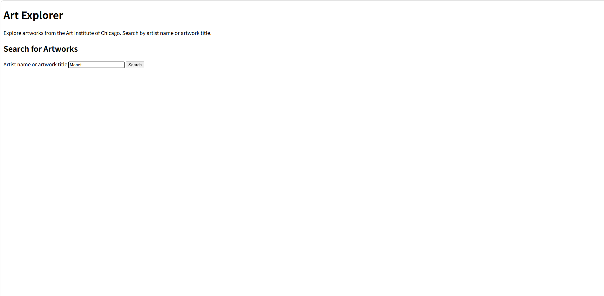
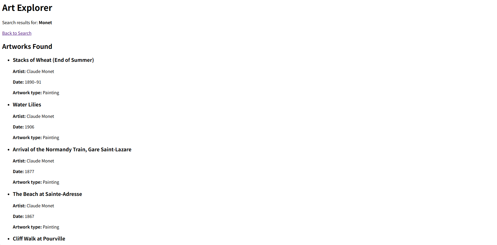

# Art Explorer

## About

Art Explorer is a web app for students and anyone interested in art to discover artworks from the Art Institute of Chicago by searching for an artist's name or an artwork title.

## How to Run

1. Install the required dependencies:

   pip install Flask requests

2. Open a terminal in the project directory containing `app.py` and run:

   python app.py

3. Open your browser and visit [http://127.0.0.1:5000/](http://127.0.0.1:5000/).

4. Enter an artist name or artwork title and click **Search** to view the results.

## Screenshot

