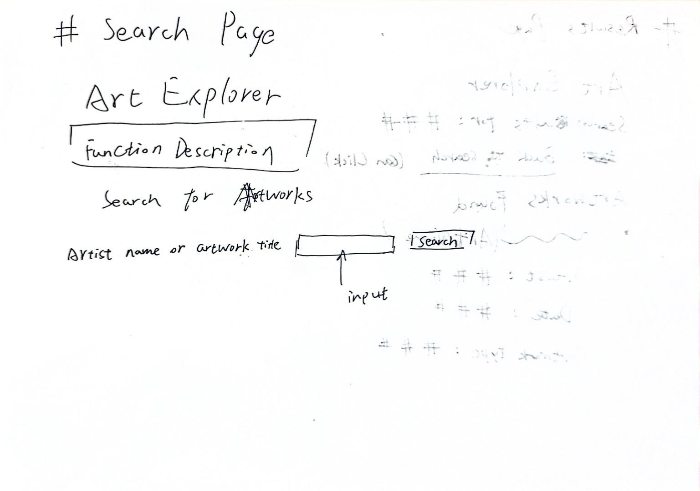
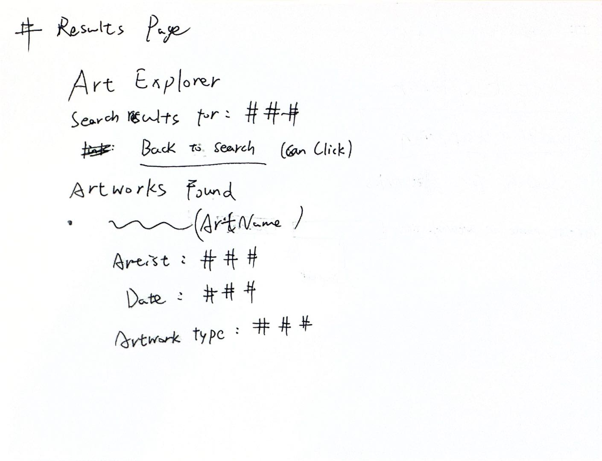

# HW4 Plan: Art Explorer

## 1. Screen Sketches

### Screen 1: Search Page

The search page will let users search for artworks by artist name or artwork title.

### Screen 2: Results Page

The results page will show artworks matching the user's search.

## 2. Data Needed

The app will use the Art Institute of Chicago API.

I plan to use these artwork fields:
- `title`: the title of an artwork
- `artist_title`: the artist's name
- `date_display`: when the artwork was made
- `artwork_type_title`: the type of artwork

The API search will check the artwork title and artist information. The app will request only the fields needed to display the results.

These fields are enough for a useful first version without making the results page too complicated.

If a field is missing, the app will display a fallback such as "Untitled artwork," "Unknown artist," "Unknown date," or "Unknown type" instead of `None`.

## 3. Function and Route Specifications

### `search_art(term)` in `api.py`

**Input:** A search term entered by the user.

**Output:**
- Return a list of artwork records when the API request succeeds and returns results.
- Return an empty list (`[]`) when the request succeeds but no artworks match.
- Return `None` when the API request fails or the response cannot be processed correctly.

**Checks:**
1. Search for `Monet` and check that relevant artworks are returned.
2. Search for a term with no matches and check that an empty list is returned.
3. Simulate an API request failure and check that `None` is returned.
4. Confirm that the function handles an invalid or unexpected API response without crashing.

### Home route in `app.py`

**Input:** A browser request to the home page.

**Output:** The search form.

**Checks:**
1. Open the home page and confirm that the search input and button appear.
2. Use Tab to navigate to the search input and button.
3. Submit an empty search and confirm that the user receives a helpful message.

### Results route in `app.py`

**Input:** The search term submitted through the form.

**Output:** A results page containing the search term and matching artworks, or an appropriate message if the input is empty, no results are found, or the API request fails.

**Checks:**
1. Search for `Monet` and confirm that artwork results appear.
2. Search for a term with no matches and confirm that a no-results message appears.
3. Submit an empty search and confirm that the user receives a helpful message.
4. Simulate an API failure and confirm that a helpful error message appears instead of the no-results message.

### `home.html`

**Input:** The home route renders the page.

**Output:** An accessible search form.

**Checks:**
1. Confirm that the search input has a visible label.
2. Confirm that the Search button submits the form.
3. Confirm that the form works with the keyboard.
4. Confirm that the empty-input message is displayed when needed.

### `results.html`

**Input:** The search term, artwork records, and any relevant status or error message.

**Output:** A results page showing the artwork list or a helpful message.

**Checks:**
1. Confirm that each result displays its title, artist, date, and artwork type.
2. Confirm that missing fields display fallback text instead of `None`.
3. Confirm that an empty list displays a no-results message.
4. Confirm that an API error displays an error message.
5. Confirm that the page provides a link back to the search page.

## 4. Implementation Plan

1. Sketch the search page and results page.
2. Build the search page and results page with hard-coded sample data.
3. Test the form-to-results flow in the browser.
4. Move the API search logic from HW3 into `api.py`.
5. Replace the sample data with real API results.
6. Test empty input, no results, API errors, and missing fields.
7. Add comments explaining the important functions, routes, and error handling.
8. Test keyboard accessibility and check the HTML labels.
9. Complete `ai_log.md` and `README.md`, including a screenshot of the working app.
10. Run the app in a browser and verify that the main user flows work correctly.